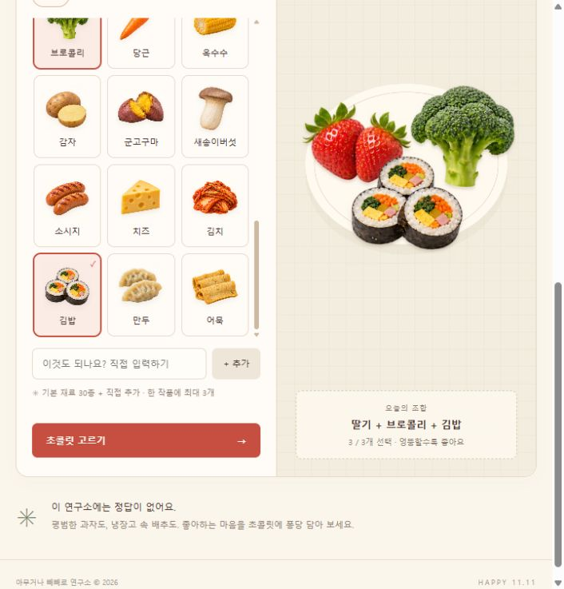

# 아무거나 빼빼로 연구소 🍫

**초콜릿만 입히면, 무엇이든 빼빼로!**

배추, 팽이버섯, 라면, 김밥까지. 30가지 음식 중 원하는 재료를 고르고, 초콜릿을 중탕해 입힌 뒤 토핑과 메시지로 꾸미는 웹 체험입니다. 완성 이미지는 복사해서 메신저나 문서에 붙여넣을 수 있습니다.



## 체험 순서

1. **재료 고르기** — 기본 재료 30종 중 최대 3개를 선택합니다. 원하는 재료 이름을 직접 추가할 수도 있습니다.
2. **초콜릿 중탕** — 밀크·다크·화이트·딸기·말차·민트 중 하나를 골라 녹입니다.
3. **초콜릿 입히기** — 재료 본래 형태와 굴곡을 살려 초콜릿을 코팅합니다. 중탕과 코팅은 반드시 거칩니다.
4. **마음껏 꾸미기** — 토핑을 고르고 미리보기를 눌러 뿌립니다. 골고루 뿌리기, 마지막 토핑 취소, 모두 지우기를 지원합니다.
5. **선물하기** — 받는 사람, 보내는 사람, 메시지와 포장지 색을 정하고 완성 이미지를 복사합니다.

## 재료 30종

| 종류 | 재료 |
| --- | --- |
| 과자 | 과자 스틱, 포스틱, 프레첼 |
| 과일 | 딸기, 바나나, 사과, 포도, 파인애플, 오렌지 |
| 채소·뿌리 | 배추, 고수, 오이, 브로콜리, 당근, 옥수수, 감자, 군고구마 |
| 버섯 | 팽이버섯, 새송이버섯 |
| 그 밖의 음식 | 수제비, 라면, 새우튀김, 떡, 베이컨, 소시지, 치즈, 김치, 김밥, 만두, 어묵 |

토핑은 레인보우, 아몬드, 하트 캔디, 참깨, 고춧가루, 김가루를 제공합니다.

## 실행하기

[Node.js](https://nodejs.org/ko/) 18 이상이 필요합니다. 별도 패키지를 설치할 필요는 없습니다.

저장소를 내려받아 프로젝트 폴더에서 실행하세요.

```sh
npm start
```

브라우저에서 **http://127.0.0.1:4173**을 열면 됩니다. 종료하려면 실행한 터미널에서 Ctrl+C를 누르세요. 이 주소는 실행한 컴퓨터에서만 접속됩니다.

### HTML 파일 하나로 전달하기

```sh
npm run build
```

생성된 **outputs/아무거나-빼빼로.html** 파일을 Chrome 또는 Edge로 열면 됩니다. 이 파일에는 이미지·스타일·기능이 모두 포함되어 있어, 다른 사람에게 이 파일 하나만 전달할 수 있습니다. 생성 후에는 로그인이나 인터넷 연결이 필요하지 않습니다.

### 다른 사람에게 웹 주소로 공유하기

사이트를 실행한 뒤 [Cloudflare Tunnel](https://developers.cloudflare.com/cloudflare-one/networks/connectors/cloudflare-tunnel/do-more-with-tunnels/trycloudflare/) 등의 서비스로 로컬 주소를 연결할 수 있습니다. 터널 실행 파일은 이 저장소에 포함하지 않습니다.

```sh
cloudflared tunnel --url http://127.0.0.1:4173
```

출력되는 HTTPS 주소를 공유하세요. 임시 터널은 PC와 서버·터널이 실행 중일 때만 접속할 수 있으며, 다시 실행하면 주소가 바뀔 수 있습니다.

## 이미지 복사

완성 이미지는 1500×1500 크기의 PNG로 만들어 클립보드에 복사합니다. 복사한 다음 메신저나 문서에 붙여넣으세요. 브라우저의 권한이나 지원 여부 때문에 자동 복사가 되지 않으면, **이미지 크게 보기**에서 이미지를 오른쪽 클릭하거나 길게 눌러 복사할 수 있습니다. 메신저에 따라 이미지 붙여넣기 지원이 다를 수 있습니다.

## 구현과 데이터

- HTML, CSS, JavaScript와 Canvas로 구현했습니다. 외부 라이브러리나 빌드 도구를 설치하지 않습니다.
- 기본 재료의 이미지는 AI로 생성한 실사 느낌의 이미지입니다. 각 이미지의 투명도와 표면 명암을 사용해 초콜릿의 굴곡·광택·코팅 경계를 표현합니다.
- 직접 추가한 재료는 이름표가 붙은 기본 모양으로 표시합니다. 입력한 이름에 맞는 이미지를 자동 생성하지는 않습니다.
- 입력한 이름·메시지와 완성 이미지는 브라우저에서 처리하며 서버에 저장하지 않습니다. 별도 공개 갤러리나 회원 기능은 없습니다.
- 실제 조리법이 아닌 상상 속 요리 체험입니다.

## 파일 안내

| 경로 | 역할 |
| --- | --- |
| dist/index.html | 사이트 화면과 안내 |
| dist/style.css | 반응형 디자인 |
| dist/app.js | 재료 선택, 만들기 과정, 토핑, 이미지 복사 |
| dist/coating.js | 재료별 초콜릿 코팅과 표면 표현 |
| dist/assets/ | 재료·토핑 이미지와 제작 설명 |
| build-standalone.cjs | 이미지까지 포함한 단일 HTML 생성 |
| start-local.cjs | 생성한 사이트만 제공하는 로컬 서버 |

문법 검사는 아래 명령으로 실행할 수 있습니다.

```sh
npm run check
```
